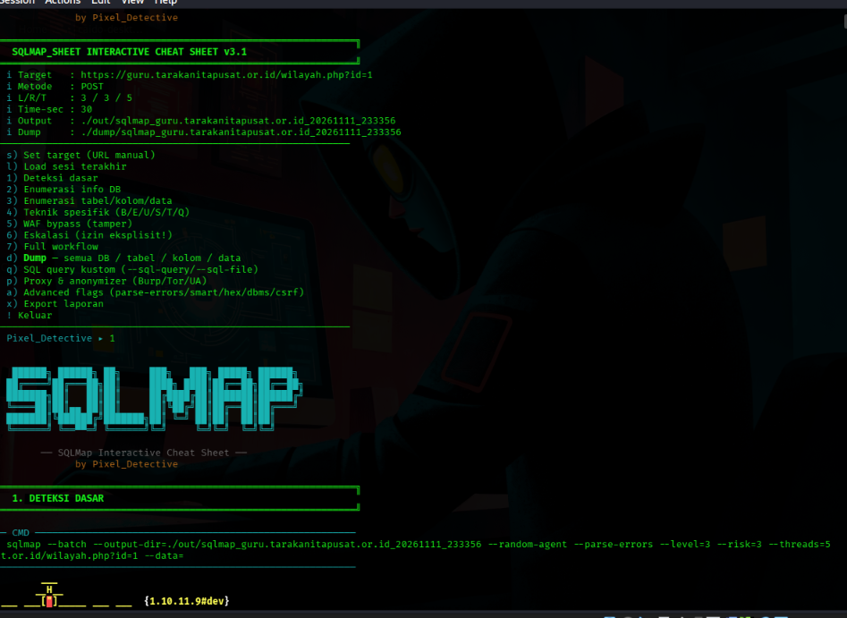

<div align="center">

# 🚀 SQLMAP_SHEET by Pixel_Detective


**SQLMAP_SHEET** adalah *Interactive Cheat Sheet* berbasis CLI untuk **SQLMap**. Script ini dirancang untuk mempermudah dan mempercepat proses *Penetration Testing* (SQL Injection) tanpa harus menghafal ratusan *flags* SQLMap. 

Dibuat dengan antarmuka interaktif yang modern, mendukung *Session Management*, *Export Report*, dan yang paling penting: **Dioptimalkan penuh untuk Termux (Android)**.

</div>

---

## 📸 Tampilan Antarmuka (Screenshot)

<div align="center">
  
</div>

---

## ✨ Fitur Utama

- 🎯 **Deteksi & Enumerasi:** Deteksi dasar, ambil nama DB, tabel, dan kolom.
- 💾 **Submenu DUMP Lengkap:** Dump semua database, tabel, kolom, hingga data spesifik dengan filter `WHERE`.
- 🛡️ **WAF Bypass:** 7 preset *tamper scripts* (Cloudflare, AWS, ModSecurity, dll) untuk menembus WAF.
- 🔑 **SQL Query Kustom:** Jalankan query manual (`--sql-query`) atau dari file (`--sql-file`).
- 🕵️ **Proxy & Anonymizer:** Dukungan Burp Suite, rotasi proxy dari file, dan Tor Network.
- ⚙️ **Advanced Flags:** Akses cepat ke `--parse-errors`, `--smart`, `--hex`, `--dbms`, dan `--csrf-token`.
- 📱 **Termux-Ready:** Deteksi otomatis layar sempit, path `$HOME`, dan fitur `termux-wake-lock` agar scan tidak terputus saat layar mati.
- 📄 **Export Laporan:** Simpan hasil pentest ke format Markdown (`.md`) atau Text (`.txt`).
- 💾 **Session Save/Load:** Simpan konfigurasi target, lanjutkan kapan saja tanpa setup ulang.

---

## 📦 Panduan Instalasi

Pilih sistem operasi yang Anda gunakan:

### 🐧 1. Instalasi di Linux (Debian/Ubuntu/Kali)
```bash
# 1. Update repositori
sudo apt update && sudo apt install -y git curl python3 python3-pip

# 2. Install SQLMap (Stable Version)
sudo apt install -y sqlmap

# 3. Clone repositori ini
git clone https://github.com/floryid/sqlmap-sheet.git
cd sqlmap-sheet

# 4. Beri izin eksekusi
chmod +x sqlmap_sheet.sh

# 5. Jalankan
./sqlmap_sheet.sh

🍏 2. Instalasi di macOS

# 1. Pastikan Homebrew terinstall, lalu install dependencies
brew install git python3 sqlmap

# 2. Clone repositori ini
git clone https://github.com/floryid/sqlmap-sheet.git
cd sqlmap-sheet

# 3. Beri izin eksekusi
chmod +x sqlmap_sheet.sh

# 4. Jalankan
./sqlmap_sheet.sh

📱 3. Instalasi di Termux (Android)

# 1. Update package Termux
pkg update && pkg upgrade -y

# 2. Install dependencies
pkg install -y python git curl termux-api

# 3. Install SQLMap via pip (versi paling update)
pip install sqlmap

# 4. Clone repositori ini
git clone https://github.com/floryid/sqlmap-sheet.git
cd sqlmap-sheet

# 5. Beri izin eksekusi
chmod +x sqlmap_sheet.sh

# 6. Jalankan
./sqlmap_sheet.sh

🚀 Cara Menjalankan
A. Mode Interaktif (Sangat Direkomendasikan)

Cukup jalankan script tanpa argumen:
./sqlmap_sheet.sh

Alur Penggunaan Cepat:

 1.   Pilih s untuk Set Target. Masukkan URL target Anda.

 2.   Pilih 1 untuk Deteksi Dasar.

 3.   Jika terdeteksi WAF, gunakan menu 5 (WAF Bypass).

 4.   Gunakan menu 2 (Enumerasi) atau d (Dump) untuk mengekstrak data.

 5.   Pilih x di akhir sesi untuk Export Laporan.

 B. Mode Batch (Untuk Otomasi / Pipeline CI/CD)

Jika Anda ingin menjalankan SQLMap tanpa masuk ke menu:
# Format: ./sqlmap_sheet.sh --batch-run <URL> [mode]

# Deteksi dasar
./sqlmap_sheet.sh --batch-run "http://target.com/page.php?id=1" detect

# Enumerasi Database & User
./sqlmap_sheet.sh --batch-run "http://target.com/page.php?id=1" enum

C. Cek Kesehatan (Dependency Check)

Untuk memastikan semua alat (SQLMap, Python, Curl) sudah terinstall dengan benar:
./sqlmap_sheet.sh --check

Test acknowledged
CTF Write-Up
Browser untuk Caido
Bug Bounty Overview
Tolak spyware
OSIRIS CTF
PowerGrid VM Info
Daftar Scope TikTok
CTF Write-Up
Langkah Main CTF VulnHub
Perbaiki warna bendera
Ukuran Tank Profil 1200 Liter
Ukuran pintu kamar mandi
Denah kos 3 barak
Test acknowledged

Berikut adalah satu skrip bash yang dapat Anda jalankan langsung di terminal untuk membuat ulang file README.md secara otomatis.

Skrip ini akan menulis seluruh konten Markdown yang sudah rapi dan modern ke dalam file README.md di direktori tempat Anda menjalankannya.

Silakan copy-paste perintah di bawah ini ke terminal Kali Linux atau Termux Anda, lalu tekan Enter:
bash

cat << 'EOF' > README.md
<div align="center">

# 🚀 SQLMAP_SHEET by Pixel_Detective


**SQLMAP_SHEET** adalah *Interactive Cheat Sheet* berbasis CLI untuk **SQLMap**. Script ini dirancang untuk mempermudah dan mempercepat proses *Penetration Testing* (SQL Injection) tanpa harus menghafal ratusan *flags* SQLMap. 

Dibuat dengan antarmuka interaktif yang modern, mendukung *Session Management*, *Export Report*, dan yang paling penting: **Dioptimalkan penuh untuk Termux (Android)**.

</div>

---

## 📸 Tampilan Antarmuka (Screenshot)

<div align="center">
  
</div>

---

## ✨ Fitur Utama

- 🎯 **Deteksi & Enumerasi:** Deteksi dasar, ambil nama DB, tabel, dan kolom.
- 💾 **Submenu DUMP Lengkap:** Dump semua database, tabel, kolom, hingga data spesifik dengan filter `WHERE`.
- 🛡️ **WAF Bypass:** 7 preset *tamper scripts* (Cloudflare, AWS, ModSecurity, dll) untuk menembus WAF.
- 🔑 **SQL Query Kustom:** Jalankan query manual (`--sql-query`) atau dari file (`--sql-file`).
- 🕵️ **Proxy & Anonymizer:** Dukungan Burp Suite, rotasi proxy dari file, dan Tor Network.
- ⚙️ **Advanced Flags:** Akses cepat ke `--parse-errors`, `--smart`, `--hex`, `--dbms`, dan `--csrf-token`.
- 📱 **Termux-Ready:** Deteksi otomatis layar sempit, path `$HOME`, dan fitur `termux-wake-lock` agar scan tidak terputus saat layar mati.
- 📄 **Export Laporan:** Simpan hasil pentest ke format Markdown (`.md`) atau Text (`.txt`).
- 💾 **Session Save/Load:** Simpan konfigurasi target, lanjutkan kapan saja tanpa setup ulang.

---

## 📦 Panduan Instalasi

Pilih sistem operasi yang Anda gunakan:

### 🐧 1. Instalasi di Linux (Debian/Ubuntu/Kali)
```bash
# 1. Update repositori
sudo apt update && sudo apt install -y git curl python3 python3-pip

# 2. Install SQLMap (Stable Version)
sudo apt install -y sqlmap

# 3. Clone repositori ini
git clone https://github.com/floryid/sqlmap-sheet.git
cd sqlmap-sheet

# 4. Beri izin eksekusi
chmod +x sqlmap_sheet.sh

# 5. Jalankan
./sqlmap_sheet.sh

🍏 2. Instalasi di macOS
bash

# 1. Pastikan Homebrew terinstall, lalu install dependencies
brew install git python3 sqlmap

# 2. Clone repositori ini
git clone https://github.com/floryid/sqlmap-sheet.git
cd sqlmap-sheet

# 3. Beri izin eksekusi
chmod +x sqlmap_sheet.sh

# 4. Jalankan
./sqlmap_sheet.sh

📱 3. Instalasi di Termux (Android)
bash

# 1. Update package Termux
pkg update && pkg upgrade -y

# 2. Install dependencies
pkg install -y python git curl termux-api

# 3. Install SQLMap via pip (versi paling update)
pip install sqlmap

# 4. Clone repositori ini
git clone https://github.com/floryid/sqlmap-sheet.git
cd sqlmap-sheet

# 5. Beri izin eksekusi
chmod +x sqlmap_sheet.sh

# 6. Jalankan
./sqlmap_sheet.sh

🚀 Cara Menjalankan
A. Mode Interaktif (Sangat Direkomendasikan)

Cukup jalankan script tanpa argumen:
bash

./sqlmap_sheet.sh

Alur Penggunaan Cepat:

    Pilih s untuk Set Target. Masukkan URL target Anda.

    Pilih 1 untuk Deteksi Dasar.

    Jika terdeteksi WAF, gunakan menu 5 (WAF Bypass).

    Gunakan menu 2 (Enumerasi) atau d (Dump) untuk mengekstrak data.

    Pilih x di akhir sesi untuk Export Laporan.

B. Mode Batch (Untuk Otomasi / Pipeline CI/CD)

Jika Anda ingin menjalankan SQLMap tanpa masuk ke menu:
bash

# Format: ./sqlmap_sheet.sh --batch-run <URL> [mode]

# Deteksi dasar
./sqlmap_sheet.sh --batch-run "http://target.com/page.php?id=1" detect

# Enumerasi Database & User
./sqlmap_sheet.sh --batch-run "http://target.com/page.php?id=1" enum

C. Cek Kesehatan (Dependency Check)

Untuk memastikan semua alat (SQLMap, Python, Curl) sudah terinstall dengan benar:
bash

./sqlmap_sheet.sh --check

🗺️ Peta Menu Interaktif
Menu	Fungsi	Keterangan
s	Set Target	Input URL, POST data, Cookie, Header, Level, Risk, Threads.
l	Load Session	Memuat konfigurasi target yang terakhir disimpan.
1	Deteksi Dasar	Menjalankan SQLMap standar untuk mencari injeksi.
2	Enumerasi Info DB	Mencari versi DBMS, user aktif, hak akses DBA, dan daftar DB.
3	Enumerasi Tabel	Mencari tabel & kolom secara bertahap.
4	Teknik Spesifik	Memaksa SQLMap menggunakan teknik B, E, U, S, T, atau Q.
5	WAF Bypass	Menjalankan Tamper Scripts (space2comment, randomcase, dll).
6	Eskalasi	Membaca file server (/etc/passwd), OS Command, atau OS Shell.
d	Submenu DUMP	Menu andalan. Dump DB, Tabel, Kolom, atau Full Data (--dump-all).
q	SQL Query	Menjalankan query manual, misal: SELECT * FROM users.
p	Proxy & Anon	Set proxy ke Burp Suite (127.0.0.1:8080) atau aktifkan Tor.
a	Advanced Flags	Ubah --dbms, --csrf-token, --eval, dll.
x	Export Laporan	Menyimpan log aktivitas dan metadata target ke .md / .txt.
!	Keluar	Keluar dari aplikasi dengan aman (melepas wake-lock).

⚠️ Disclaimer & Etika (Wajib Dibaca)

    1. IZIN ADALAH SEGALANYA.
    Alat ini hanya boleh digunakan untuk:

        Menguji sistem milik Anda sendiri (Lab / DVWA / bWAPP).

        Menguji sistem klien yang memiliki Surat Izin Tertulis (Rules of Engagement/Scope).

    2. JANGAN PERNAH melakukan scan atau eksploitasi pada situs/domain publik tanpa izin tertulis. Ini melanggar hukum (UU ITE di Indonesia, CFAA di AS, dll).

    3. Penulis (Pixel_Detective) TIDAK BERTANGGUNG JAWAB atas segala penyalahgunaan alat ini. Segala risiko ditanggung oleh pengguna.

    <div align="center"> <i>Dibuat dengan ❤️ oleh <b>Pixel_Detective</b> untuk komunitas keamanan siber.</i> </div> 

